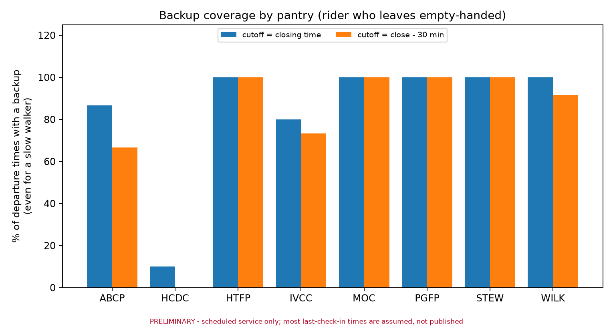
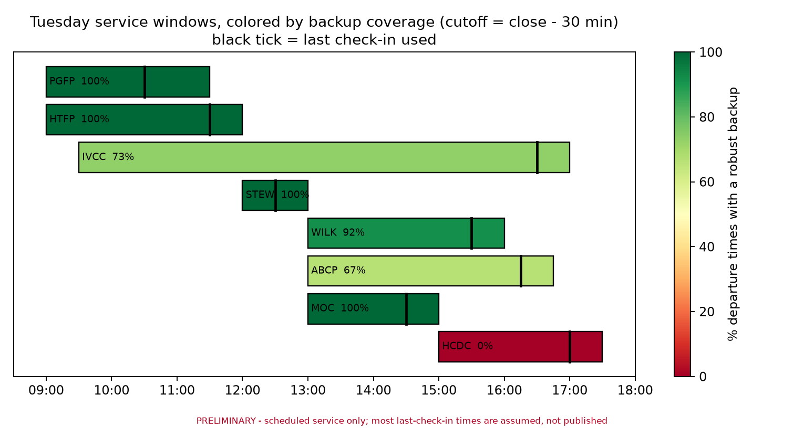

# Dallas Pantry Backup

**If someone arrives at a Dallas food pantry and leaves empty-handed, can they still reach a second pantry by DART before it stops taking people?**

A pantry map shows where pantries are. It does not show whether a second pantry is *open, reachable and still accepting people* by the time you get there. This project combines published pantry hours with DART's scheduled bus and rail service to answer that, pair by pair and minute by minute.

> **Status: preliminary.** One service day (Tuesday, Dec 1, 2026), 8 pantries, scheduled service only, and most pantries' last check-in times are *assumed*, not published. The method is validated against DART's trip planner; the findings are not yet confirmed with the pantries. See [Limitations](#limitations).

## What it finds (so far)

Share of departure times (every 15 minutes through each pantry's open window) at which a rider leaving that pantry has at least one other eligible pantry they can still reach in time, **even assuming a slow walker** and tight connections:





| Origin pantry | Cutoff = closing time | Cutoff = closing time - 30 min |
|---|---:|---:|
| Pleasant Grove Food Pantry (PGFP) | 100% | 100% |
| Holy Trinity Food Pantry (HTFP) | 100% | 100% |
| Mission Oak Cliff (MOC) | 100% | 100% |
| The Stewpot (STEW) | 100% | 100% |
| Wilkinson Center (WILK) | 100% | 92% |
| Inspired Vision Compassion Center (IVCC) | 80% | 73% |
| Aunt Bette's Community Pantry (ABCP) | 87% | 67% |
| Harmony CDC (HCDC) | 10% | 0% |

How to read this, honestly:

- **Pantries open at overlapping times near each other cover for one another.** The 1 pm cluster (Wilkinson, Aunt Bette's, Mission Oak Cliff) plus all-day Inspired Vision accounts for most of the high numbers. This is a statement about *this sample of 8*, not about Dallas.
- **Late afternoon is thin.** Coverage drops for Aunt Bette's and Inspired Vision when cutoffs move earlier, because most other pantries have closed by 3 to 4 pm. That is a schedule gap, so it does not depend on walking-speed assumptions.
- **Harmony CDC shows almost no backup because of geography.** In this sample no other pantry is reachable in time: even its best optimistic connection to Inspired Vision misses that pantry's assumed 4:30 pm cutoff by about 22 minutes. That reflects which pantries I included, not Harmony's real situation. Pantries near Harmony would need to be added before saying anything about it.
- **One connection is fragile.** Inspired Vision to Pleasant Grove works only if the rider catches a 9:41 bus after a ~10-minute walk. A slower walker lands at or after Pleasant Grove's published 10:30 a.m. new-client cutoff.
- **No result here should be read as "pantry X is failing people."** These are scheduled opportunities, not observed pickups.

## How it works

1. **Inputs:** DART's GTFS schedule for one service date; a table of pantry hours (`data/pantry_hours.csv`, one row per pantry per weekday, each with a source URL).
2. **Scenarios:** a rider leaves pantry A every 15 minutes during A's open window (someone who was turned away or ran out of time).
3. **Routing:** a connection-scan earliest-arrival search over the day's ~355,000 scheduled connections: walk to a stop, ride, transfer (including short walks between nearby stops), walk to pantry B.
4. **Backup:** B is a *backup* if the rider arrives no later than B's last check-in, no more than 30 minutes before B opens, and the two pantries' eligibility rules (stated ZIP codes) overlap.
5. **Robustness:** every scenario is run under three assumption sets and labeled **robust** (works even under pessimistic assumptions), **possible**, or **no**. A "definite near-miss" misses even under optimistic assumptions.

| | Optimistic | Baseline | Pessimistic |
|---|---:|---:|---:|
| Walking speed | 5.5 km/h | 4.8 km/h | 3.6 km/h |
| Street detour factor | 1.15 | 1.25 | 1.35 |
| Max walk to/from a stop | 1.2 km | 1.0 km | 0.6 km |
| Same-stop transfer buffer | 3 min | 4 min | 5 min |
| Walking-transfer extra buffer | 0.5 min | 1 min | 2 min |

Other scripts find the smallest change at a destination that would create a backup, and test shifting one pantry's window by 15 to 60 minutes with total hours fixed.

## Validation

I compared the model with DART's own trip planner on three trips (Dec 1, 2026):

| Trip | Leave | Model arrives | Planner arrives | Note |
|---|---:|---:|---:|---|
| Stewpot to Mission Oak Cliff | 12:15 | 12:52 | 12:52 | Exact match, same routes |
| Inspired Vision to Stewpot | 9:30 | 10:48 | 10:52 | Model 4 min earlier: same Green Line train, but it rides bus 001 after the train where the planner walks |
| Inspired Vision to Pleasant Grove | 9:30 | 10:30 | 9:54 | Model estimated a 13-minute walk to the first stop versus the planner's 10, missed the 9:41 bus by a minute and caught a later one. With a 10-minute walk it arrives 9:52, matching the planner |

Three trips is a small check, not a proof of accuracy. The last row shows why every result is also reported under optimistic and pessimistic walking assumptions: a one-minute difference can flip whether a bus is caught.

### Mistakes found and fixed along the way

These are kept here on purpose, because they are the reason the robustness layer exists.

1. **Arriving hours before a pantry opens was counted as a backup.** A rider leaving a 9 am pantry was credited with a 1 pm pantry. Fixed with a 30-minute maximum wait; backup coverage fell sharply.
2. **No walking transfers.** Transfers were allowed only at the identical stop, but in real DART data connecting stops are often across the street or between a bus bay and a rail platform. Two apparent near-misses were artifacts. Fixed with walking transfers up to 400 m.
3. **Walking-distance cap excluded a stop 15 minutes away.** Raised to 1.0 km.
4. **Threshold sensitivity.** Small walking-time differences flip bus connections, so findings are now bracketed instead of reported from a single parameter set.

## Reproduce

Requires Python 3.12+ (tested on 3.13 and 3.14).

```bash
pip install -r requirements.txt
python -m pytest tests                                   # 9 tests

# 1. download DART's schedule and check it covers your date
python scripts/fetch_and_check_dart.py --date 2026-12-01

# 2. build the pantry input for one weekday (geocodes via the US Census geocoder;
#    if an address fails, fill lat/lon in data/pantry_hours.csv by hand)
python scripts/build_pantries.py --day Tue                                        # cutoff = closing time
python scripts/build_pantries.py --day Tue --assume-checkin-before-close 30       # more conservative

# 3. analyse
python scripts/run_robust.py --gtfs data/dart_gtfs --pantries data/pantries.csv --date 2026-12-01 --tag _close
python scripts/explain_trip.py --from IVCC --to PGFP --depart 09:25               # itinerary for spot-checking

# 4. figures
python scripts/make_report_figures.py --tags _close _m30 --labels "cutoff = closing time" "cutoff = close - 30 min"
```

Running `python scripts/run_analysis.py` with no arguments uses a made-up synthetic city so you can test the pipeline without any real data. All figures from that mode are stamped SYNTHETIC.

DART's schedule changes periodically (the feed used here covers 2026-11-15 to 2026-12-06), so rerun step 1 and choose a date inside the feed you download.

## Data sources

- **Transit:** DART static GTFS feed, `https://www.dart.org/transitdata/latest/google_transit.zip` (feed version V761-218-220-20261115, service dates 2026-11-15 to 2026-12-06). The feed is not redistributed here; please review DART's terms before reusing or republishing it. This project is not affiliated with or endorsed by DART.
- **Pantry hours and rules:** read from each organization's own web page on 2026-11-21, with the URL recorded per row in `data/pantry_hours.csv`. Not yet confirmed by phone or email. Pantries: [Pleasant Grove Food Pantry](https://www.pleasantgrovefoodpantry.org/our-clients), [Inspired Vision Compassion Center](https://www.ivcompassion.org/faq), [The Stewpot](https://www.thestewpot.org/food-pantry), [Wilkinson Center](https://www.thewilkinsoncenter.org/food-and-support-services/), [Vickery Meadow Food Pantry](https://vickerymeadowna.org/need-food/), [Holy Trinity Food Pantry](https://htdallas.org/ht-food-pantry/), [Aunt Bette's Community Pantry](https://www.stphilips1600.org/community-services/foodpantry.cfm), [Mission Oak Cliff](https://www.missionoakcliff.org/service-list), [Harmony CDC](https://www.harmonycdc.org/food-pantry/).
- **Geocoding:** US Census Bureau geocoder.

## Limitations

- **Scheduled service only.** No delays, cancellations, real-time data, or fare/payment issues.
- **Most last-check-in times are assumed** (closing time, or 30 minutes earlier), flagged `checkin_assumed` in the data. Only Pleasant Grove publishes one (10:30 a.m. for new clients).
- **Walk-in acceptance is unconfirmed for several pantries.** Holy Trinity is appointment-based, Harmony and Mission Oak Cliff do not say outright that same-day walk-ins are accepted, and Aunt Bette's page lists open enrollment only through Oct 31, 2026. Questions to each are pending.
- **Eligibility is only partly modeled.** ZIP-code rules are used where stated; income, ID and proof-of-address requirements are not.
- **Small sample, one weekday.** Eight pantries on one Tuesday. Pantries not in the sample could change every conclusion above.
- **Walking is estimated from straight-line distance** with a detour factor, not street routing, and it assumes an able-bodied walker. It does not model wheelchairs, strollers, carrying food, weather, or safety.
- **A scheduled connection is not a successful pickup.** Pantries can run out of food before their cutoff.
- **Not for individual advice.** Do not use this to tell a specific person where to go; hours change and the data is unconfirmed.

## Roadmap

- Replies from pantries on cutoffs and walk-in rules; replace assumed times with confirmed ones.
- Add pantries near Harmony CDC and across more of Dallas, using the North Texas Food Bank's partner list.
- Run other weekdays and Saturdays.
- Calibrate walking times against more planner comparisons.
- A concrete, checkable scheduling suggestion for any pair that stays a near-miss after confirmation.

## Repository layout

```
src/pantrynet/    gtfs.py (loader), csa.py (router), analysis.py, plots.py, synth.py (demo data)
scripts/          fetch_and_check_dart.py, build_pantries.py, run_analysis.py, run_robust.py,
                  explain_trip.py, make_report_figures.py
data/             pantry_hours.csv (sourced hours), pantries_template.csv
docs/             figures used in this README
tests/            9 tests
```
